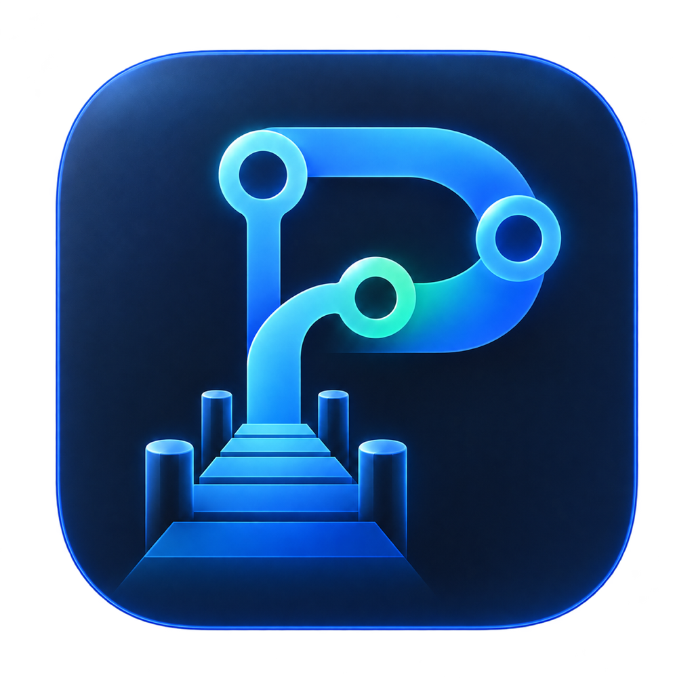
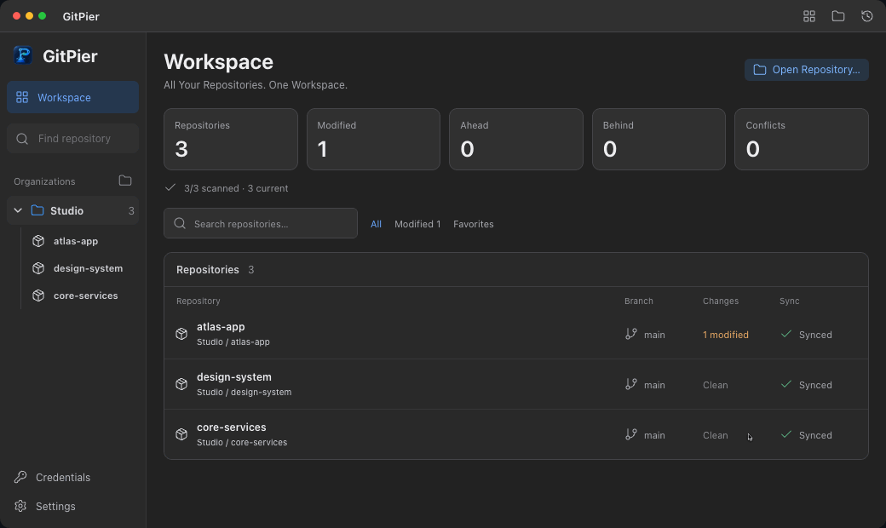

<p align="center">
  
</p>
<h1 align="center">GitPier</h1>
<p align="center">
  <strong>Native Git Client for macOS</strong><br>
  All Your Repositories. One Workspace.
</p>
<p align="center">English · <a href="README.zh-CN.md">简体中文</a></p>

GitPier is a native Git client for macOS, built with Swift, SwiftUI, and AppKit. Manage your repositories in one workspace, review changes side by side, and switch between Git workflows, your editor, and an integrated terminal without losing track of the repository you're working in.

<details open>
<summary>Product demo (expand/collapse)</summary>

<picture>
  <source media="(prefers-reduced-motion: reduce) and (max-width: 600px)" srcset=".github/assets/gitpier-demo-compact.png">
  <source media="(prefers-reduced-motion: reduce)" srcset=".github/assets/gitpier-demo.png">
  <source media="(max-width: 600px)" srcset=".github/assets/gitpier-demo-compact.gif">
  
</picture>

</details>

## Features

### One workspace for your repositories

- See repository status in the Dashboard, filter and favorite repositories, and search repositories, branches, commits, and files locally.
- Group repositories into organizations, save their order, manage Worktrees, and use Task Workspaces for separate branches and working directories.
- Use **⌘K** for Quick Open, optionally watch local changes, and run batch Fetch after review. Automatic remote checks are optional and off by default; they update tracking references without merging or pushing.

### Everyday Git, with review built in

- Open or clone repositories; commit, amend, Commit & Push, fetch, pull, and push. Manage branches, remotes, tags, and stashes.
- Review selected files without losing partial staging or changes staged by other tools. Stage or unstage whole files, supported hunks, or selected changed lines.
- Merge branches, run interactive rebases, cherry-pick commits in order, and revert commits. Choose the mainline explicitly when reverting a merge commit. Resolve supported text conflicts in the app, and review the state before continuing an interrupted operation.
- Import and export patches, work with submodules, and inspect Git LFS files and rules when the separate Git LFS tool is installed.

### See what changed, and why

- Side-by-side or unified Diff, syntax colors, file type icons, line numbers, whitespace controls, and synchronized scrolling.
- Search and browse paged commit history with a commit graph and file previews. Use Git Blame, compare branches, or recover a Reflog entry into a new branch.
- Check local Branch Health for ahead/behind/diverged states, upstream and Worktree information, and optional merged-into analysis. Remote counts reflect the last local tracking snapshot.

### Keep your tools close

- A PTY terminal with tabs, splits, and search, plus integration with installed or custom external editors.
- An optional [navigation CLI](docs/cli.md): `gitpier open . --page history` opens your repository in the GitPier app you selected.
- Optionally run a separately installed Codex CLI in Task Workspaces. Codex uses your own installation, authentication, and service plan; GitPier does not bundle a model.
- Contextual guidance suggests next steps. The Operations Center shows progress and diagnostics, retains local commit results, and offers explicit Push verification and recovery.

### Connect your hosting accounts

- Connect GitHub.com, GitLab.com, self-hosted GitLab, and Gitea accounts through OAuth or PAT, and link repositories to accounts.
- Browse pull/merge requests, commits, files, conversations, and available CI results; create requests and submit supported comments or reviews after confirmation.
- Capabilities vary by provider. GitLab Discussions and approvals are separate operations; use the browser for Gitea formal reviews and unsupported inline operations. See [hosting setup and limits](docs/development.md#hosting-setup).
- Configure hosting API tokens and Git Fetch/Push credentials separately. New hosting accounts use a Local Encrypted Vault by default; you can also choose macOS Keychain.

### At home on macOS

The interface is available in English and Simplified Chinese, with light, dark, or system appearance. Native menus and keyboard shortcuts, shared compact overlay scrollbars, offline help, and configurable completion notifications are included. In-app updates use Sparkle with signed update metadata and packages.

## Install

Requires **macOS 14 or later** and a working Git installation. The release **Universal DMG** contains Apple silicon and Intel builds.

1. Download the DMG from the [latest release](https://github.com/Heisenberg2024/gitpier/releases/latest). A SHA-256 file is provided for integrity checks.
2. Open the DMG and drag **GitPier.app** to **Applications**.
3. Launch GitPier, then open or clone a repository.

The distributed app is **ad-hoc signed, without Developer ID signing or Apple notarization**. If macOS blocks the first launch, verify the download source and integrity. Then follow [Apple's instructions for opening a trusted app](https://support.apple.com/en-us/102445), using System Settings → Privacy & Security → Open Anyway where offered. Stop if macOS reports malware or a damaged app; do not disable Gatekeeper or remove quarantine.

Manage update checks in **Settings → About**. New installations check automatically; existing opt-outs are preserved. Downloading, installing, and restarting require confirmation. Update signatures authenticate GitPier's update channel; they do not mean the app is Apple notarized.

## Build from source

Use macOS 14 or later, **Xcode 16 or later with Swift 6**, its command-line tools, Git, and Python 3.9+. Dependencies are managed by Swift Package Manager and pinned in `Package.resolved`.

```sh
git clone https://github.com/Heisenberg2024/gitpier.git
cd gitpier
Scripts/build-app.sh
Scripts/test.sh
```

The build produces `dist/GitPier.app` for the current architecture. For a Universal app, use `UNIVERSAL=1 Scripts/build-app.sh`. The default local signature is ad-hoc. See the [development guide](docs/development.md) for toolchain notes, native acceptance, optional tools, and packaging.

## Security & privacy

GitPier works with local repositories and your installed Git. Git hooks, commit signing, TLS verification, and SSH host-key checks remain enabled. Terminals, hooks, external tools, and optional agents run with your user permissions; review repositories and commands you do not trust.

Hosting credentials can use Keychain or a local encrypted vault. The vault stores its keys on the same Mac. Anyone with access to both the keys and ciphertext can decrypt the credentials. Logs, paths, review metadata, and screenshots can contain private information. Read [Security & Privacy](SECURITY.md) before sharing diagnostics or connecting accounts.

## Contributing

Bug reports, focused pull requests, and documentation improvements are welcome. Start with [Contributing](CONTRIBUTING.md), the [development guide](docs/development.md), and the [architecture overview](docs/architecture.md). Report sensitive issues using the process in [SECURITY.md](SECURITY.md).

Release history lives in the [changelog](CHANGELOG.md) and [GitHub Releases](https://github.com/Heisenberg2024/gitpier/releases). Future directions are in the [roadmap](ROADMAP.md).

## License

[MIT](LICENSE) © Heisenberg2024. Dependencies, bundled file icons, and platform marks retain their respective terms; see [third-party notices](THIRD_PARTY_NOTICES.md).
