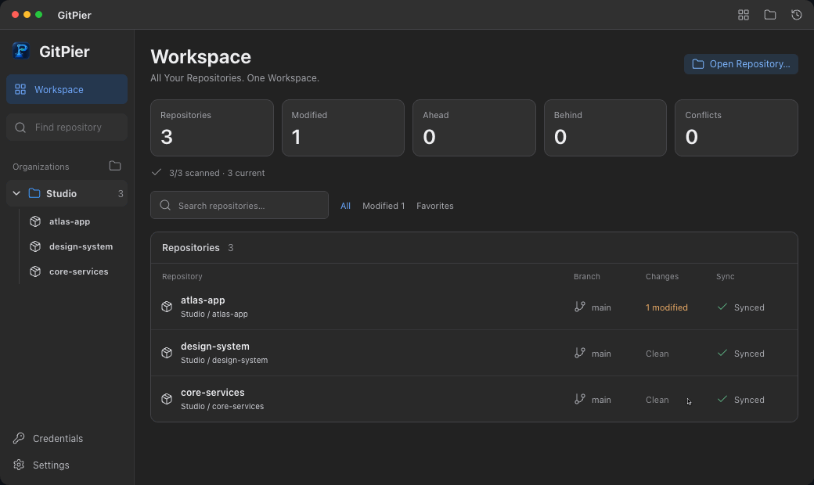

<p align="center">
  
</p>
<h1 align="center">GitPier</h1>
<p align="center">
  <strong>Native Git Client for macOS</strong><br>
  All Your Repositories. One Workspace.
</p>
<p align="center"><a href="README.md">English</a> · 简体中文</p>

GitPier 是使用 Swift、SwiftUI 和 AppKit 构建的 macOS 原生 Git 客户端。你可以在一个工作空间管理多个仓库，并排审查变更，在 Git 工作流、编辑器和内置终端之间切换，同时保留当前仓库的上下文。

<details open>
<summary>产品演示（展开/收起）</summary>

<picture>
  <source media="(prefers-reduced-motion: reduce) and (max-width: 600px)" srcset=".github/assets/gitpier-demo-compact.png">
  <source media="(prefers-reduced-motion: reduce)" srcset=".github/assets/gitpier-demo.png">
  <source media="(max-width: 600px)" srcset=".github/assets/gitpier-demo-compact.gif">
  
</picture>

</details>

## 主要功能

### 在一个工作空间管理仓库

- 在 Dashboard 总览中查看仓库状态，筛选或收藏仓库，并在本地搜索仓库、分支、提交和文件。
- 用组织归类仓库并保存排列顺序，管理 Worktree，通过任务工作空间隔离分支和工作目录。
- 按 **⌘K** 快速打开仓库；也可按需监听本地变更，在审查后批量获取。自动远程检查默认关闭，启用后只更新跟踪引用，不自动合并或推送。

### 在日常 Git 操作中审查变更

- 打开或克隆仓库，提交、修改最后一次提交、提交并推送，以及获取、拉取和推送。管理分支、远程、标签和 Stash。
- 审查所选文件时，保留已有的部分暂存内容和其他工具暂存的变更。可暂存或取消暂存整个文件、受支持的差异块或选中的变更行。
- 支持合并、交互式变基、有序 Cherry-pick 和 Revert；撤销合并提交时明确选择主线父提交。可在应用中解决受支持的文本冲突，并在继续中断的操作前审查状态。
- 导入和导出补丁、管理子模块；单独安装 Git LFS 后，可查看 LFS 文件和管理规则。

### 看清变更及其来由

- 并排或统一 Diff，支持语法着色、文件类型图标、行号、空白显示和同步滚动。
- 搜索并分页浏览提交历史，查看提交图和文件预览，使用 Git Blame、比较分支，或从 Reflog 创建恢复分支。
- 查看本地分支的领先、落后、分叉状态，以及上游和 Worktree 信息；也可按需分析是否已合入指定分支。远程计数依据最近的本地跟踪快照。

### 让开发工具随手可用

- 带标签、分屏和搜索的 PTY 终端，支持已安装或自定义外部编辑器。
- 可选的[导航 CLI](docs/cli.md)：运行 `gitpier open . --page history`，在所选的 GitPier 应用中打开当前仓库。
- 可在任务工作空间中运行单独安装的 Codex CLI。Codex 使用你自己的安装、认证和服务方案，GitPier 不内置模型。
- 根据当前上下文查看下一步操作建议。操作中心显示进度和诊断信息，保留本地提交结果，并提供主动核实推送结果和恢复操作的入口。

### 连接代码托管账号

- 通过 OAuth 或 PAT 连接 GitHub.com、GitLab.com、自托管 GitLab 和 Gitea，并关联仓库与账号。
- 浏览 PR/MR、提交、文件、讨论及可用的 CI 结果；确认后创建请求，提交受支持的评论或审查。
- 各平台支持的操作不同：GitLab Discussion 与 Approval 分别执行；Gitea 正式审查及不支持的逐行操作提供浏览器入口。详见[托管配置与限制](docs/development.md#hosting-setup)。
- Git 获取和推送所用的凭证与托管 API Token 独立配置。新托管账号默认使用本地加密凭证库，也可选择 macOS 钥匙串。

### 熟悉的 macOS 体验

界面支持英语和简体中文，外观可选浅色、深色或跟随系统。还提供原生菜单和快捷键、统一的短覆盖滚动条、离线帮助，以及可配置的操作完成通知。应用内更新使用 Sparkle 验证更新元数据和安装包签名。

## 安装

需要 **macOS 14 或更高版本**及可用的 Git。正式发行的 **Universal DMG** 同时包含 Apple silicon 和 Intel 构建。

1. 从[最新发布页](https://github.com/Heisenberg2024/gitpier/releases/latest)下载 DMG，可使用随附的 SHA-256 文件核对完整性。
2. 打开 DMG，将 **GitPier.app** 拖入 **Applications（应用程序）**。
3. 启动 GitPier，打开或克隆仓库。

当前发行包采用 **ad-hoc 签名，尚未使用 Developer ID 签名或完成 Apple 公证**。若 macOS 阻止首次启动，请先核实下载来源和完整性，再按 [Apple 关于打开可信应用的说明](https://support.apple.com/en-us/102445)操作。系统提供该选项时，可通过“系统设置 → 隐私与安全性 → 仍要打开”确认。若系统报告恶意软件或应用损坏，应停止操作；不要关闭 Gatekeeper 或移除隔离属性。

在**设置 → 关于**管理更新检查。新安装默认自动检查，已有的关闭设置会保留。下载、安装和重启均需确认。更新签名用于验证 GitPier 更新渠道的来源，不代表 Apple 公证。

## 从源码构建

使用 macOS 14 或更高版本、**Xcode 16 或更高版本及 Swift 6**、对应命令行工具、Git 和 Python 3.9+。依赖由 Swift Package Manager 管理，并通过 `Package.resolved` 固定版本。

```sh
git clone https://github.com/Heisenberg2024/gitpier.git
cd gitpier
Scripts/build-app.sh
Scripts/test.sh
```

构建后会生成当前架构的 `dist/GitPier.app`。构建通用应用时，运行 `UNIVERSAL=1 Scripts/build-app.sh`，本地默认采用 ad-hoc 签名。工具链说明、原生验收、可选工具及打包方法见[开发指南](docs/development.md)。

## 安全与隐私

GitPier 使用本地仓库和已安装的 Git，保留 Git Hooks、提交签名、TLS 验证及 SSH 主机密钥检查。终端、Hooks、外部工具和可选代理以当前用户权限运行；请先审查不可信的仓库和命令。

托管凭证可使用钥匙串或本地加密凭证库。本地凭证库的密钥也保存在同一台 Mac 上，同时取得密钥和密文的人即可解密凭证。日志、路径、审查元数据及截图可能包含私人信息；分享诊断或连接账号前，请阅读[安全与隐私说明](SECURITY.md)。

## 参与贡献

欢迎提交问题报告、范围明确的 Pull Request 和文档改进。请先阅读[贡献指南](CONTRIBUTING.md)、[开发指南](docs/development.md)及[架构概览](docs/architecture.md)。敏感问题请按 [SECURITY.md](SECURITY.md) 的流程报告。

版本历史见[变更记录](CHANGELOG.md)和 [GitHub Releases](https://github.com/Heisenberg2024/gitpier/releases)，后续方向见[路线图](ROADMAP.md)。

## 许可证

[MIT](LICENSE) © Heisenberg2024。依赖、内置文件图标及平台标志分别遵循其适用条款，详见[第三方声明](THIRD_PARTY_NOTICES.md)。
