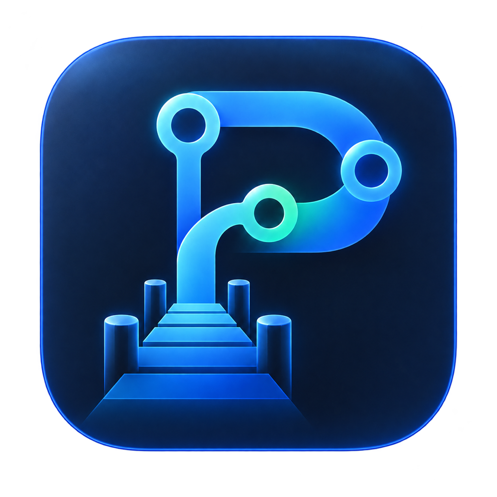
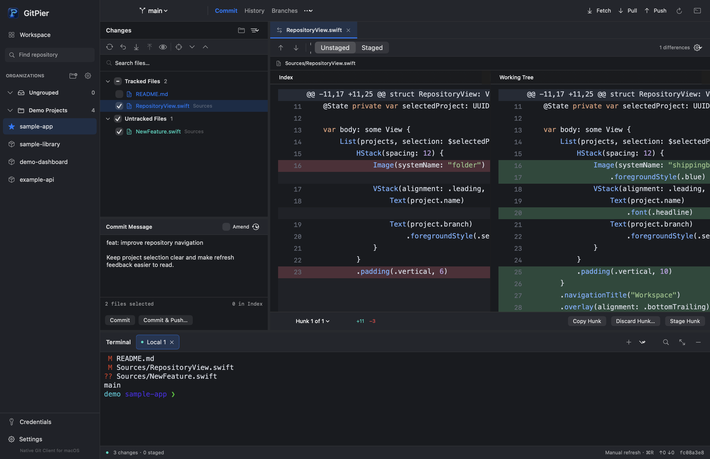
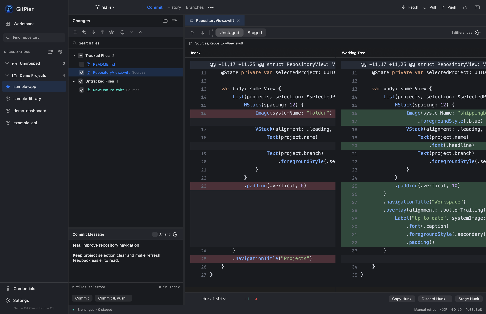
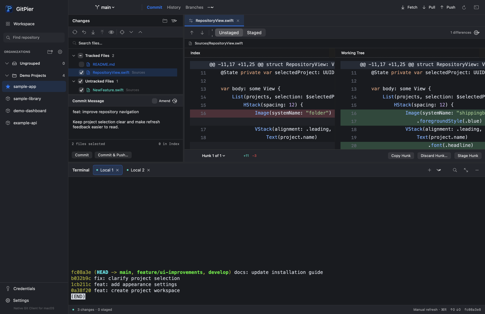
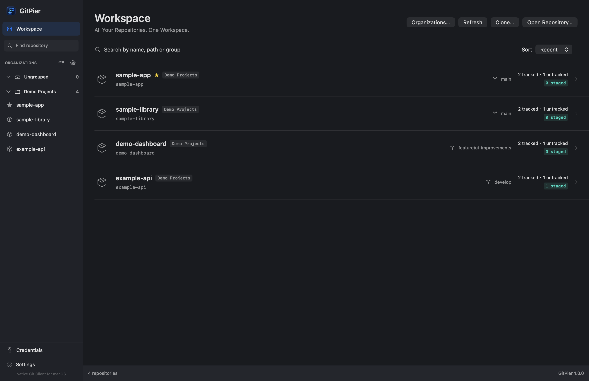

<p align="center">
  
</p>
<h1 align="center">GitPier</h1>
<p align="center">
  <strong>Native Git Client for macOS</strong><br>
  All Your Repositories. One Workspace.
</p>
<p align="center"><a href="README.md">English</a> · 简体中文</p>

GitPier 将仓库管理、变更审查、提交和集成终端汇集在一个专注的 macOS 工作空间中。应用采用 Swift、SwiftUI 和 AppKit 开发，直接使用本地仓库和已安装的 Git。



## main 开发中 — v2.1.0

**2.1.0（35）为尚未发布的开发候选。** 操作中心保留未决检查点，支持复制完整 Hash、打开历史，以及主动核实已保存的单分支推送和原远端引用。重试须审查并重新核对原来源与目标，不会再次创建提交；上下文建议会突出此前未确认的结果。

Dashboard 在单次采集中复用元数据，合并刷新通知，并在每次渲染中复用远端检查说明。Push 预检仅在同一校验阶段复用读取结果，各边界仍重新校验。[性能续作](docs/v2.1.0-performance.md)记录配对比较及其边界。独立 `Marketing/hero-demo/` 已从当前仓库树移除。详见[开发计划](docs/v2.1.0-plan.md)及[实际验收、性能和剩余门槛](docs/v2.1.0-testing.md)。稳定下载仍为 v2.0.1，未创建 v2.1.0 Tag 或 Release。

## 稳定性与性能 — v2.0.1

[v2.0.1（34）](https://github.com/Heisenberg2024/gitpier/releases/tag/v2.0.1)现已正式发布为 **Latest**。仓库刷新减少重复Git查询并保留最终一致性校验；提交中断时保留诊断，完成状态不明则提示核实；恢复推送保留原提交和目标，不重复Commit或Merge。

Universal安装包支持macOS 14及以上。详见[验收与未验证边界](docs/v2.0.1-testing.md)和[发布证据](docs/development.md#v201-publication--2026-11-02)。Developer ID签名与Apple公证继续作为后续独立工作。

## 产品质量与原生体验 — v2.0.0

v2.0.0 加强 Index 审查快照的一致性，在后续推送失败或取消时保留本地提交成功结果，并复用现有工作空间预算限制快速切换 Diff 的并发。原生体验精修包括历史多选与键盘导航、明确的操作状态、每次操作的诊断详情，以及按界面语言显示日期；Dashboard 调度使用可复现的大规模数据测量。

已于 2026-11-02 从 `b99f72f` 将 [v2.0.0（33）](https://github.com/Heisenberg2024/gitpier/releases/tag/v2.0.0)正式发布为 **Latest**；同源 Swift 6.1.2 CI 通过 1,065 项 Core、零失败/错误/跳过，通用包、生产更新签名、附件回读与公开下载/Latest Feed 已核验。详见[发布证据与边界](docs/development.md#v200-publication--2026-11-02)。

性能取舍与未验证范围见[路线图](ROADMAP.md)、[实施记录](docs/v2.0.0-plan.md)和[质量验收](docs/v2.0.0-testing.md)。Developer ID 与 Apple 公证继续作为后续独立里程碑。

## 功能

- **多仓库管理。** 切换仓库和 Worktree，通过组织管理项目，在侧栏和组织页面拖动仓库并保存顺序。从组织内打开的仓库会自动归属该组织。
- **专注的提交流程。** 使用独立文件复选框选择变更，审查选中内容，执行提交或提交并推送。保留已有部分暂存和其他工具暂存的变更。有界确认页具体说明 Index、HEAD 和分支的变化；**已审查，稍后提交**只确认当前快照，之后发生新变化仍需重新审查，提交时也会再次校验。
- **处理推送拒绝。** 远程分支有新提交时，确认“合并并推送”即可获取、合并后重试推送。本地提交始终保留；出现冲突时停止推送，交由你解决。合并前请先提交或 Stash 剩余的已跟踪文件修改。
- **应用内解决冲突。** 对照当前版本与传入版本、预览共同祖先，逐块采用一侧或保留双方，并编辑合并结果。保存并标记文件解决后，审查并继续合并；待完成的合并推送保持原目标。二进制和大型文件支持整文件版本或删除选择。
- **完成没有文件差异的合并。** 待完成的合并会在仓库各页面持续显示。即使文件列表为空且未填写草稿，提交页仍提供“完成合并”；先审查按序父提交、合并说明和暂存结果，再创建合并提交。
- **双栏 Diff。** 通过行号、语法着色、同步垂直滚动和轻量滚动条比较代码；Index 一侧为空时，工作区占满宽度。对支持的 Hunk 执行暂存、取消暂存或丢弃，并通过标签保留文件。
- **统一滚动体验。** 列表、设置、帮助、提交说明、标签栏、Sheet、Popover、嵌套编辑器和终端缓冲区统一使用 Diff 的短覆盖滑块，滚动时加深，停顿后淡化。提交页文件列表复用原生行视图，减少大量文件下的滚动卡顿。
- **集成终端。** 在真实 PTY 中运行已安装的 Shell，支持多标签、分屏和搜索。每个仓库保留自己的会话和工作目录。
- **历史与分支。** 浏览提交图，管理分支、远程、Stash 和标签，通过 Git 执行获取、拉取、推送、合并和变基。
- **选择主线撤销合并。** 在历史中右键 Revert，查看合并提交按序编号的父提交、Hash 和标题，选择作为主线的父提交后确认创建撤销提交。保留原有历史，执行前复核工作树与 Index，沿用 Hooks、签名和冲突恢复，不会自动推送。
- **全历史与 Stash 预览。** Git 原生全历史分页查询支持消息、Hash、作者、日期与分支过滤；Stash 预览复用文件列表与双栏 Diff。
- **历史审查与布局。** 历史页复用提交页的 Diff 渲染和滚动条，按仓库保存详情高度与文件列表宽度；再次点击选中记录或按 Esc 关闭详情。
- **编辑器与帮助。** 按优先级从带应用图标的下拉列表选择默认编辑器，并添加自定义 App。仓库和提交文件的右键菜单通过“在编辑器中打开”子菜单选择本次使用的编辑器，并保留应用图标。帮助菜单提供内置的中英文离线使用指南。
- **凭证管理。** 使用 macOS Keychain 保存 HTTPS Token，并选择 SSH 身份配置。支持既有 Git 凭证助手、SSH 配置、Hooks 和提交签名。

支持英语与简体中文界面、深浅主题及跟随系统外观。点击仓库或应用切回前台时主动刷新，也可使用 **⌘R** 手动刷新；可选文件监听会提示外部变更。完成通知在传输结束后展示最终操作结果。

打开或选择仓库时始终进入提交页，不持久化当前页面。侧栏支持一键收起或展开全部组织的仓库。

## 专业工作流与仓库健康 — v1.9.0

v1.9.0 新增 History 的 1–200 个提交有序审查，展示完整提交 Hash、目标工作树/分支/HEAD，并复用现有 Diff。Cherry-pick 使用 Git 原生 Sequencer；重复补丁和空结果停止等待明确恢复，合并提交直接拒绝，不猜测主线。普通提交与合并提交的 Revert 共用有界确认和 Diff 入口，合并撤销仍须显式选择父提交。继续、跳过和中止会重新核验原仓库与已审查状态，已确认写入不会因关闭页面而取消。

Branches 新增只读本地健康分析：上游引用是否存在、领先/落后/分叉、最近活动、工作树占用，以及针对选择的真实本地分支分析祖先关系是否已合并（仅预选有据可查的远端 HEAD 对应本地分支）。观察时间与上次应用获取时间（或未知）明确数据来源，不隐式获取或清理分支；长期未活动不代表可以安全删除。Branches、Dashboard 与上下文建议共用已同步／领先／落后／已分叉／未设置上游／状态未知六种语义和辅助功能计数；已合并、未合并、无法证明与未分析的祖先关系独立显示。原生状态图标统一使用绿色表示同步／合并、自适应主文本色表示领先、蓝色表示落后、橙色表示分叉、中性灰色表示未知／无上游；当前检出、同步和合并使用不同图标。Dashboard 与上下文建议继续复用已有本地快照采集和恢复入口。

已于 2026-11-01 从 `9df9364` 将 [v1.9.0（32）](https://github.com/Heisenberg2024/gitpier/releases/tag/v1.9.0)正式发布为 **Latest**。同源码 Swift 6.1.2 CI 通过 1056 项 Core 测试，通用 DMG、生产更新签名、公开下载与 Latest 更新源已核验。详见[发布证据与边界](docs/development.md#v190-publication--2026-11-01)及[开发验收与尚未验证的硬件、分发场景](docs/v1.9.0-testing.md)。

## 专业 Git 工作流 — v1.2.0

已发布的 [v1.2.0](https://github.com/Heisenberg2024/gitpier/releases/tag/v1.2.0) 增加引用日志恢复、安全的 Worktree 生命周期管理、任意本地 / 远程跟踪分支比较及 Git Blame，复用 Git 原生查询和现有 macOS 面板。恢复优先创建新分支，比较与 Blame 保持只读；未知或存在修改的工作树目录不可删除。Blame 支持最大 4 MiB 的 UTF-8 文本，每页查询 400 行。详情见[变更记录](CHANGELOG.md)及[开发验证说明](docs/development.md)。通过 GitHub Latest Release 安装，或从 v1.1.0 使用“检查更新”升级。

## 提交与仓库工作流 — v1.3.0

已发布的 [v1.3.0](https://github.com/Heisenberg2024/gitpier/releases/tag/v1.3.0)（构建号 19）增加交互式变基，支持经过审查的 Pick/Reword/Squash/Fixup/Drop 计划、提交顺序调整、Git 原生冲突处理和需要审查的 Continue/Skip/Abort 恢复，最多处理 200 个线性提交。Hooks、签名、部分暂存和生产更新身份继续受到保护。本地与发布验证结果见[开发指南](docs/development.md#v130-release-validation--2026-10-15)。

菜单使用不带附加指示箭头的紧凑标签，变基操作控件与拖动图标对齐，关于页完整显示在一个设置页面。开启自动检查后，会在启动时及 Sparkle 的定时计划中检查，并提供原生更新提醒；下载和安装仍需要确认。

在 Diff 行号区选择修改行，逐行暂存或取消暂存，同时保留其他暂存与工作区修改。逐行操作支持有大小限制的常规文本修改、CRLF 和末尾无换行；复杂文件变更和过滤器继续使用文件 / 差异块流程。刷新或切换文件、对比方式会清除选区。

导出文件、差异块、选中行、提交或两端提交范围补丁；应用普通 Diff 补丁前先预览并校验，工作区与 Index 是独立目标。提交邮件导出使用 format-patch；邮件导入 / git am、重命名 / 复制 / 符号链接 / gitlink 导入及二进制 delta 仍交由终端处理。导入限制为 8 MiB / 200 个文件，并限制字面量二进制数据大小。

Git LFS 页面检测可选工具，展示规则 / 文件 / OID / Pointer，审查根目录 .gitattributes 修改，并通过现有凭据执行需确认的 Fetch/Pull。不安装 LFS、过滤器或 Hooks，不自动转换已有文件或暂存规则。子模块展示声明 / 登记 URL 与 HEAD / Index / 父 gitlink，支持审查后的 Init/Sync/Add、独立的记录 / 远程提交检出，并可在 GitPier、编辑器或终端打开子仓库。嵌套条目先保持只读，打开其父仓库后再管理；不提供 Deinit / 移除及自动递归更新。

## 工作空间总览 — v1.4.0

已发布的 [v1.4.0](https://github.com/Heisenberg2024/gitpier/releases/tag/v1.4.0)（构建号 20）增加本地工作空间总览，显示已扫描 / 全部数量，支持修改 / 暂存 / 领先 / 落后 / 冲突 / 不可用 / 收藏筛选、多选和关联 Worktree 展开收起。卡片使用独立内存缓存及有界后台查询；打开 Dashboard 不会读取每个仓库的 Diff 或历史。启动扫描仅查询本地。领先 / 落后依据本地跟踪引用，不代表服务器实时状态；无上游及不可用仓库明确区分。可选外部监听仍只标记需要刷新。

[v1.4.1](https://github.com/Heisenberg2024/gitpier/releases/tag/v1.4.1)（构建号 21）采用居中自适应布局，增加五项可点击概览、搜索框与紧凑筛选、对齐的仓库 / 分支 / 修改 / 同步信息列，以及上下文选择栏。概览与筛选沿用同时匹配规则。小窗口将分支放在仓库名称下方；折叠 Worktree 仍计入匹配数和选择范围。不可用行可查看完整错误并刷新。克隆、组织管理和快速打开位于顶部更多菜单。

选择单个条目、组织匹配项或全部匹配项，再通过“获取已选仓库”审查每个仓库和远程。搜索或筛选时保留选择，并明确显示当前结果之外的所选数量。有界获取队列对远程配置一致的关联 Worktree 去重，保留工作区、Index 和 FETCH_HEAD，并独立显示成功 / 失败 / 取消结果，失败可审查后重试。不增加批量 Pull、Push、Reset 或 Rebase。

已发布的 [v1.4.2](https://github.com/Heisenberg2024/gitpier/releases/tag/v1.4.2)（构建号 22）新增原生三态“选择匹配项”，范围包括折叠 Worktree。审查 Fetch 并确认后清除已被队列接受的选择，取消或未提交的错误项保留。手动获取全部成功后五秒收起详情，失败保留审查与重试入口。

**设置 → Git → 自动远程检查**默认关闭，与本地文件监听独立。开启后仅在 GitPier 活动期间连接已配置远程：当前仓库默认15分钟（另可选10/30/60），工作空间其他仓库约45分钟，分批最多两并发。可限制范围或排除当前仓库。优先检查分支配置的远程，没有上游时使用 Git 默认远程；同配置 Worktree 共享获取；失败后退避5–60分钟，认证失败后暂停，凭证变化或 Git 设置中的**重新检查自动认证**可恢复。既有 Git 凭证、配置的助手、HTTP 认证、原有 Askpass 程序、SSH Agent、文件私钥与原生钱包可直接用于首次自动获取，无需先手动获取；公开仓库无需已保存凭证。设置显示凭证来源与能力；**配置后台认证**仅在主动点击后请求系统授权，**初始化 SSH 认证**可加载 Agent 身份且不执行获取。认证沿用 Git 原始配置，不按平台或助手名称限制；禁止新增终端登录和 GitPier 回退登录框，原有 Git/SSH Askpass 程序及助手保留自身授权行为。工作文件、Index、分支、标签及清理仍由你控制。

本地扫描保持离线。Dashboard 区分“跟踪引用一致”和已成功联网检查的同步状态，Tooltip提供远程/本地时间及失败原因。Fetch显示检查中/过期/失败，Pull和Push显示非零数量及分叉/无上游提示；后台更新跟踪计数时保留草稿、Diff标签和仓库页面。

**已发布 [v1.4.3](https://github.com/Heisenberg2024/gitpier/releases/tag/v1.4.3)（23）：**专用后台凭证进程禁止传统登录钥匙串授权窗口，无法静默读取时停止检查并等待手动认证，修复 v1.4.2 自动获取期间反复授权的问题。在安装修复版前，受影响的 v1.4.2 用户请先关闭自动获取。保留手动认证和既有凭证访问控制。

**已发布 [v1.4.4](https://github.com/Heisenberg2024/gitpier/releases/tag/v1.4.4)（构建号 24）。**自动获取统一复用 Git 原生认证，覆盖 HTTP、HTTPS、SSH、Git 和本地传输，不区分 GitHub、GitLab、Gitee 等平台。命名助手、绝对路径助手和 Shell 助手保留原顺序、URL/账号/路径匹配及完整协议响应；自动 Git 只请求 get，不调用 store/erase。不再把已保存密码或 Agent 当成获取前提：公开仓库可匿名获取，是否需要认证由实际服务器决定。SSH 保留原始命令、配置、Agent、文件私钥、Provider 和原生钥匙串行为。终端 Clone、GitPier Clone 以及 init/push 仓库使用相同流程；Clone 所选账号在自动检查前绑定。HTTP 仍是明文传输，设置中显示提示；GitPier 托管 HTTPS Token 仍拒绝 HTTP。既有凭证必须能被应用的 Git 进程访问，无法恢复未保存的密码或仅存在于另一个终端会话的环境变量。详见[安全边界](SECURITY.md)和[验证记录](docs/development.md#unified-native-authentication)。

“工作空间搜索”支持名称、路径、组织、分支、远程名称，以及按需查询已跟踪文件路径和提交信息 / 哈希。范围可选全部 / 当前组织 / 当前仓库 / 已选仓库，结果打开仓库、已有 Diff / 文件历史或提交详情。Git 查询可取消、分页并限制结果及输出，不建立源码内容索引或上传到第三方。**⌘⇧P** 打开快速切换，支持最近 / 收藏仓库、组织匹配、上下方向键、回车和 Esc；终端焦点保留原有按键。Universal DMG 是当前正式下载，发布验证结果见[开发指南](docs/development.md#v200-publication--2026-11-02)。

## 代码托管与凭证存储 — v1.5.0

原生“代码托管”设置新增 GitHub Device Flow 验证码授权、GitLab 浏览器 S256 PKCE，以及 Gitea 公共客户端 PKCE 与本机回环回调，保留 PAT 备用。平台卡片使用官方图标，整卡可点击；GitHub 自动打开验证页，GitLab 使用默认浏览器普通标签及 State/PKCE 应用回调，避免系统认证会话的重复提示。已内置 GitHub.com 与 GitLab.com 公共 Client ID，普通用户无需自行注册应用；自建实例使用各自的公开配置。不需要 Client Secret 或 GitPier 自建后端。

支持多账号及仓库独立关联。新 OAuth/PAT 账号默认使用本地加密凭证库（AES-256-GCM、各账号独立随机密钥保存在本机），重启后按需自动恢复，无需 OAuth 钥匙串授权。可按账号选择系统钥匙串，重启后通过“验证连接”恢复；代码托管设置支持更改新账号默认值及确认后逐账号迁移。同账号并发刷新合并、整对保存；保存失败会明确提示仅当前会话有效。密钥与密文同时泄露时 Token 可被恢复，详见[凭证存储与安全边界](docs/credential-storage.md)。原 Git 凭证、助手、SSH、Remote、Upstream 和自动 Fetch 保持独立。

仓库 → More → 拉取 / 合并请求提供分页列表、详情、准确提交的 CI/Pipeline、提交、只读文件 Diff 及审查评论。创建 PR/MR 必须先检查已推送分支并确认，不会自动 Push 或盲目重试未知结果。Dashboard 为已关联仓库增加轻量摘要，宽写入权限必须主动重新授权。真实平台 OAuth/私有 API 验收结果见开发验证说明，隔离测试不能替代真实登录。详见[OAuth 注册与限制](docs/oauth-setup.md)和[开发验证说明](docs/development.md)。

## 托管稳定性 — v1.5.1

断开先停止账号会话并移除关联，再清理凭证。macOS 拒绝删除的副本会明确显示为已断开、待主动重试清理；它们不会在重启后恢复账号。

请求概览、提交、文件、审查和 CI 独立按需加载，各自保留错误、分页、取消、缓存和重试。不支持审查 API 不影响文件和提交；CI 无权限会明确显示权限错误。远端 Diff 保持只读。详见[验收与尚待真实平台验证的项目](docs/development.md#v151-hosting-stability-validation)。

## 代码审查与协作 — v1.6.0

已发布的 [v1.6.0](https://github.com/Heisenberg2024/gitpier/releases/tag/v1.6.0)（构建号 27）新增经确认的评论、线程回复和审查草稿，分别遵循各平台原生 API 语义。目标与逐行位置绑定准确账号、仓库及提交；结果未知时保留草稿并禁止自动重发。GitHub 审查决定与多行评论、GitLab Discussion/Approval、线程解决和审批规则，以及 Gitea 已验证能力详见[代码审查指南](docs/code-review.md)。同时新增 GitHub/Gitea 追加审查者及主动加载的收件箱/当前分支入口；本地比较明确使用此 Mac 的分支和远程跟踪快照。Gitea 正式审查及缺少安全条件或尚未验证的操作保留浏览器入口。[开发指南](docs/development.md#v160-publication--2026-10-18)分别记录 CI、Fixture 与真实服务写入验收边界。

## 审查稳定性 — v1.6.1

已发布的 [v1.6.1](https://github.com/Heisenberg2024/gitpier/releases/tag/v1.6.1)（构建号28）在确认后的审查写入前保存最小操作意图，重启后持续显示未知结果。正文与代码不落盘，重新打开不会重发请求。可只读回查已知结果，在平台核实后主动确认，再重新预览新的提交；断开会确认所有窗口中的草稿丢弃。详见[恢复与平台限制](docs/code-review.md)及[验收状态](docs/v1.6.1-validation.md)。同提交Swift 6.1.2 CI通过855项Core与10项发布门控，已核验签名公开附件和Latest更新Feed。本轮已授权测试仓库完成17项真实审查操作；GitLab普通评论1项保持未知并跨重启保留。缺少合资格账号的审批/审查者请求仍未验收，具体范围见验收矩阵。

## 工作流整合 — v1.7.0

已发布的 [v1.7.0](https://github.com/Heisenberg2024/gitpier/releases/tag/v1.7.0)（构建号29）增加跨窗口[操作中心](docs/operations-center.md)、既有 **⌘⇧P 快速打开**中的命令，以及仅负责导航的 [GitPier CLI](docs/cli.md)。使用 `gitpier open . --page history` 可从终端返回选定应用；在设置 → 终端安装/卸载，保留已有文件和 Shell 配置。继续复用原有 Git 写入确认、凭证和 Review Journal 恢复。上下文助手包含五级真实状态、原生磨砂浮层和残留蓝框修复。同源码 Swift 6.1.2 CI 通过932项Core，独立审核、签名附件回读与公开下载核验均通过；[发布证据与系统验收边界](docs/development.md#v170-publication--2026-10-19)分别记录。

[上下文工作流助手](docs/context-workflow.md)位于**仓库工具栏分支名称左侧的紧凑状态按钮**。正常、建议、注意、警告及冲突/阻塞采用不同图标，宽度固定；仅落后跟踪提交不会被判为冲突。浮层主体和箭头共用系统原生磨砂材质，移除关闭按钮，通过 Esc、外部点击或再次点击入口关闭。原生 Popover 根据当前 Worktree、分支、修改和 Fetch 快照解释建议及原因，风险优先；提交页内普通修改保持低调。比较页先打开再读取本地跟踪快照，同步审查在核对完成前禁用写入按钮。继续复用原确认与目标复核。尚未结束的合并会持续显示独立状态栏，直至完成或中止；助手不会自动执行 Git 操作。

## 提交与合并可靠性 — v1.8.1

已于 2026-10-29 正式发布 [v1.8.1](https://github.com/Heisenberg2024/gitpier/releases/tag/v1.8.1)（构建号 31）：改善提交页大量文件的滚动性能，修复大体积暂存资源加载，支持完成无文件差异的待完成合并，并为合并撤销提供主线父提交审查。同源码完整 CI 通过 1010 项 Core；Universal DMG、生产更新签名和公开下载/Latest Feed 均已核验。[发布证据与剩余边界](docs/development.md#v181-publication--2026-10-29)分别记录。

## 任务工作空间 — v1.8.0

已于 2026-10-22 发布 [v1.8.0](https://github.com/Heisenberg2024/gitpier/releases/tag/v1.8.0)（构建号 30）。同源码 Swift 6.1.2 CI 与本地打包均通过 993 项 Core 测试；通用 DMG、生产更新签名、附件回读和公开下载核验通过。[发布证据与剩余检查](docs/development.md#v180-publication--2026-10-22)分别记录。

提交确认按已审查的 Index、HEAD 和分支快照判断变化，解释实际前后差异，不再重复过时提示；真实变化仍需校验，保留部分暂存、Hooks 与签名。大量文件在有界确认页内滚动，操作按钮始终可达。

详情导航绑定发起时的任务、仓库与页面选择；切换后，尚未提交选择的迟到打开会被拒绝，成功提交选择后来源视图关闭仍保持成功。重复打开终端复用运行中的任务终端；已确认的审查与归档写入保留独立生命周期。

[任务工作空间](docs/task-workspaces.md)提供独立任务工作树、本地基准、显式审查与仅元数据归档。可选的已安装 Codex CLI 仅在用户确认后，从选定工作树的既有 PTY 启动；审查同时覆盖 Agent 新建提交及 Index/工作树修改。外部 URL 添加陌生仓库前需要确认。创建失败会保留可恢复的登记记录；登记成功与自动打开分别报告，导航失败后可重新打开已保存任务，详情刷新不会取消已确认的审查或归档；主动登录检查复用 CLI 环境且不读凭证，高级 Codex Home 设置兼容 Finder 启动。

## 界面截图


### 双栏 Diff



### 集成终端



### 仓库总览



## 安装

GitPier 要求 **macOS 14 或更高版本**。

从 [GitHub Latest Release](https://github.com/Heisenberg2024/gitpier/releases/latest) 下载当前正式版。请选择最新发行版附带的通用 DMG。打开 DMG，将真实的 GitPier 图标拖入 Applications，然后从 Applications 启动。

v1.1.0 的内置更新采用 Sparkle 2、GitHub Releases 和 EdDSA 签名 DMG；自动检查默认关闭，下载与安装需要确认。生产公钥已配置，发行资产必须在发布前完成签名和验证。v1.0.3 没有内置更新，需要手动升级一次。

当前采用 ad-hoc 签名，未使用 Apple Developer ID，也未完成 Apple 公证。首次安装可能遇到 Gatekeeper 提示；请核实来源并遵循 macOS 提供的安全选项，不要关闭 Gatekeeper 或移除隔离属性。


## 从源码构建

需要 macOS、**Xcode 16 或更高版本**及其命令行工具、**Swift 6.0 或更高版本**和 Git。依赖通过 Swift Package Manager 管理，并由 `Package.resolved` 锁定。可在 Xcode 中打开 `Package.swift` 浏览工程，或在仓库根目录构建应用：

```bash
Scripts/build-app.sh
open dist/GitPier.app
```

脚本为当前架构构建 Release 应用、打包资源并执行本地 ad-hoc 签名。生成包含 Apple silicon 和 Intel 二进制的本地通用 DMG 候选包（需要 Finder 图形会话）：

```bash
Scripts/package-release.sh --unsigned-candidate
```

测试与构建选项见[开发说明](docs/development.md)，实现细节见[架构说明](docs/architecture.md)。

普通文档更新走轻量 CI；同一提交的 main/tag 仅复用已证实成功的完整 macOS 验证，每个发布提交仍必须通过全部 Core、签名、应用包和 DMG 检查。手动运行始终执行完整验证，详见 [CI 策略](docs/development.md#ci-validation-policy)。

完整 CI 使用两个测试 worker，并按工具链隔离 SwiftPM 构建缓存；校验内容后恢复输入时间戳，使重新检出的未变源码可以复用编译结果。命中缓存仍执行全部测试与发布门槛；各阶段设置超时并留存测试日志，便于排查卡住或失败的运行。

## 安全与隐私

Git 操作在本机执行。受管理的 HTTPS Token 保存在 macOS Keychain 中，工作空间元数据和草稿保存在本地。GitPier 没有仓库上传或分析服务；远程操作连接用户选择的 Git Remote。Git Hooks、凭证助手和终端命令以当前用户权限执行，也可能访问网络。

提交审查保留外部 Index 和部分暂存内容。破坏性操作需要确认。GitPier 不会自动修改全局 Git、SSH 或 Shell 配置。分享日志或报告凭证问题前，请阅读[安全说明](SECURITY.md)。

## 参与贡献

欢迎提交问题报告与 Pull Request。请先阅读[贡献指南](CONTRIBUTING.md)，使用临时仓库复现 Git 问题，并移除附件中的私人数据。

## 许可证

GitPier 采用 [MIT License](LICENSE)。Copyright (c) 2026 Heisenberg2024。

第三方组件保留各自许可证，详见[第三方声明](THIRD_PARTY_NOTICES.md)。
