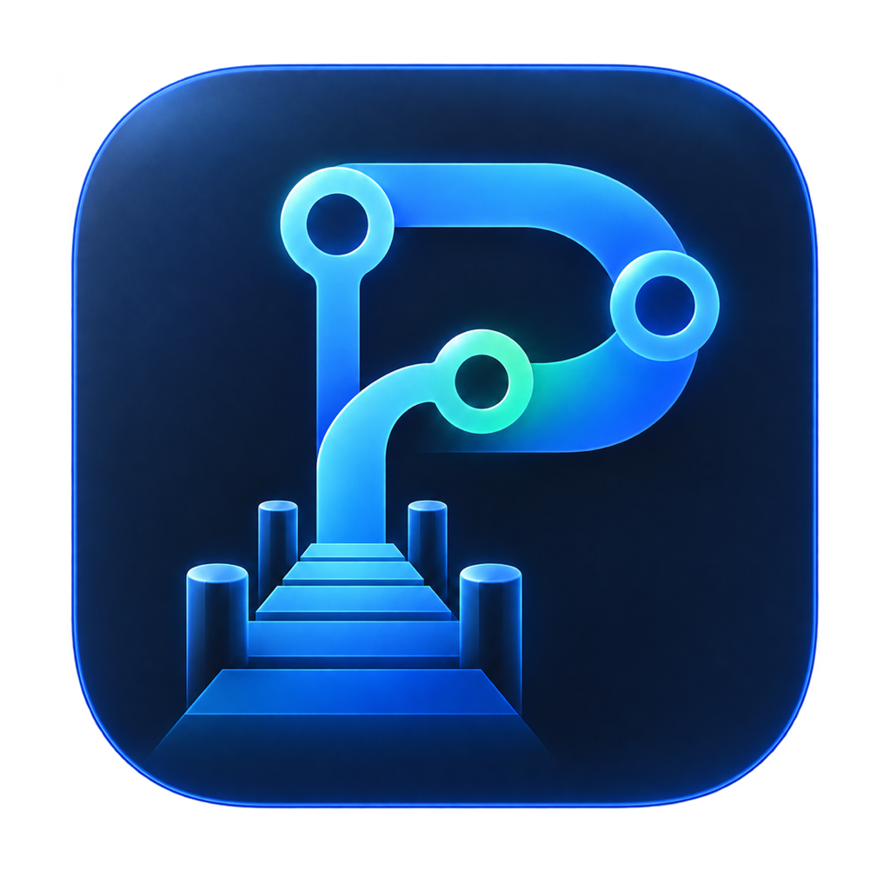
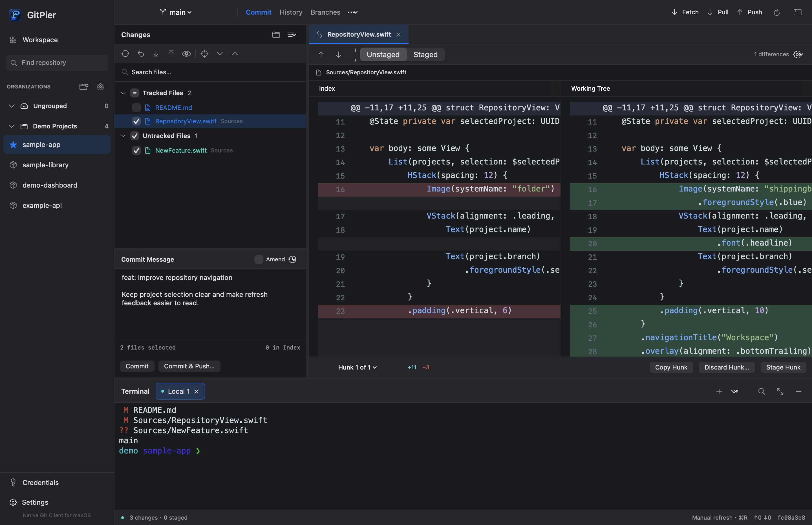
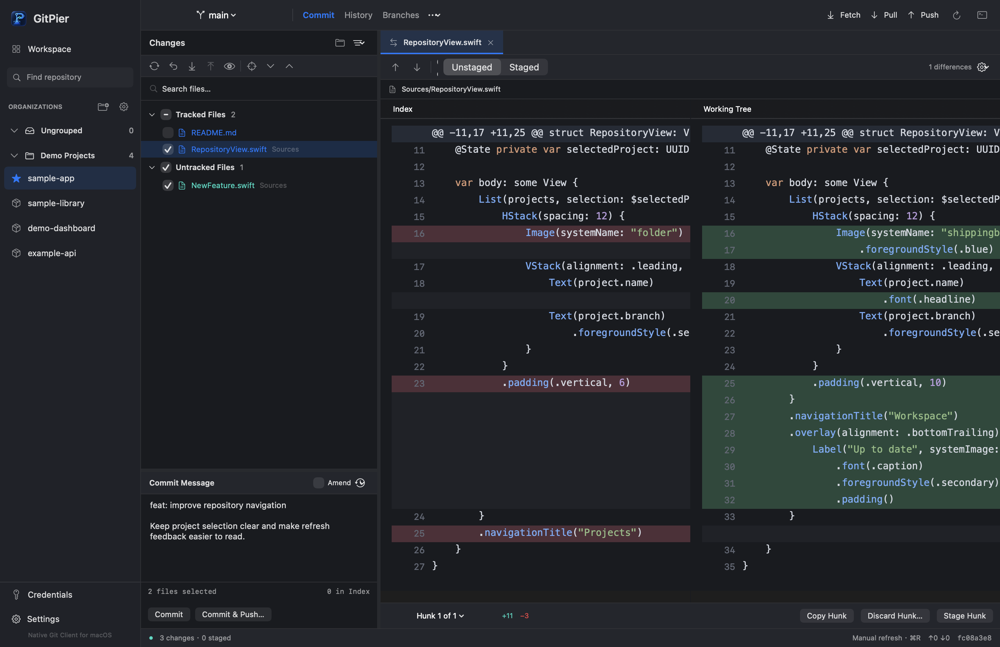
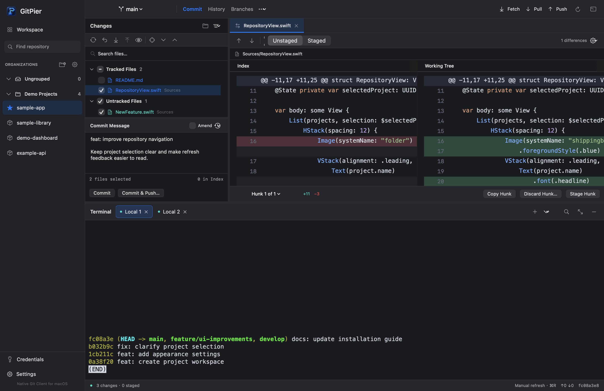
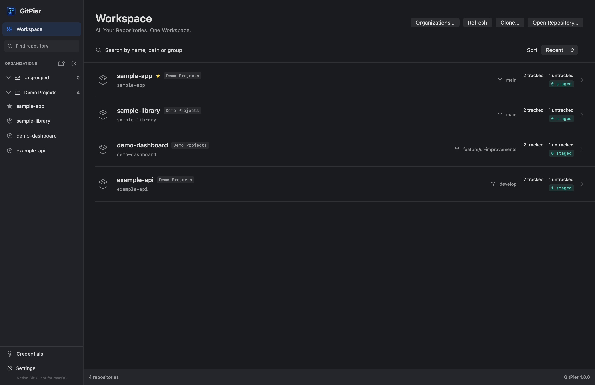

<p align="center">
  
</p>
<h1 align="center">GitPier</h1>
<p align="center">
  <strong>Native Git Client for macOS</strong><br>
  All Your Repositories. One Workspace.
</p>
<p align="center"><a href="README.md">English</a> · 简体中文</p>

GitPier 将仓库管理、变更审查、提交和集成终端汇集在一个专注的 macOS 工作空间中。应用采用 Swift、SwiftUI 和 AppKit 开发，直接使用本地仓库和已安装的 Git。



## 功能

- **多仓库管理。** 切换仓库和 Worktree，通过组织管理项目，在侧栏和组织页面拖动仓库并保存顺序。从组织内打开的仓库会自动归属该组织。
- **专注的提交流程。** 使用独立文件复选框选择变更，审查选中内容，执行提交或提交并推送。保留已有部分暂存和其他工具暂存的变更。
- **处理推送拒绝。** 远程分支有新提交时，确认“合并并推送”即可获取、合并后重试推送。本地提交始终保留；出现冲突时停止推送，交由你解决。合并前请先提交或 Stash 剩余的已跟踪文件修改。
- **应用内解决冲突。** 对照当前版本与传入版本、预览共同祖先，逐块采用一侧或保留双方，并编辑合并结果。保存并标记文件解决后，审查并继续合并；待完成的合并推送保持原目标。二进制和大型文件支持整文件版本或删除选择。
- **双栏 Diff。** 通过行号、语法着色、同步垂直滚动和轻量滚动条比较代码；Index 一侧为空时，工作区占满宽度。对支持的 Hunk 执行暂存、取消暂存或丢弃，并通过标签保留文件。
- **统一滚动体验。** 列表、设置、帮助、提交说明、标签栏和终端缓冲区统一使用 Diff 的短覆盖滑块，滚动时加深，停顿后淡化。
- **集成终端。** 在真实 PTY 中运行已安装的 Shell，支持多标签、分屏和搜索。每个仓库保留自己的会话和工作目录。
- **历史与分支。** 浏览提交图，管理分支、远程、Stash 和标签，通过 Git 执行获取、拉取、推送、合并和变基。
- **全历史与 Stash 预览。** Git 原生全历史分页查询支持消息、Hash、作者、日期与分支过滤；Stash 预览复用文件列表与双栏 Diff。
- **历史审查与布局。** 历史页复用提交页的 Diff 渲染和滚动条，按仓库保存详情高度与文件列表宽度；再次点击选中记录或按 Esc 关闭详情。
- **编辑器与帮助。** 按优先级从带应用图标的下拉列表选择默认编辑器，并添加自定义 App。仓库和提交文件的右键菜单通过“在编辑器中打开”子菜单选择本次使用的编辑器，并保留应用图标。帮助菜单提供内置的中英文离线使用指南。
- **凭证管理。** 使用 macOS Keychain 保存 HTTPS Token，并选择 SSH 身份配置。支持既有 Git 凭证助手、SSH 配置、Hooks 和提交签名。

支持英语与简体中文界面、深浅主题及跟随系统外观。点击仓库或应用切回前台时主动刷新，也可使用 **⌘R** 手动刷新；可选文件监听会提示外部变更。完成通知在传输结束后展示最终操作结果。

打开或选择仓库时始终进入提交页，不持久化当前页面。侧栏支持一键收起或展开全部组织的仓库。

## 专业 Git 工作流 — v1.2.0

已发布的 [v1.2.0](https://github.com/Heisenberg2024/gitpier/releases/tag/v1.2.0) 增加引用日志恢复、安全的 Worktree 生命周期管理、任意本地 / 远程跟踪分支比较及 Git Blame，复用 Git 原生查询和现有 macOS 面板。恢复优先创建新分支，比较与 Blame 保持只读；未知或存在修改的工作树目录不可删除。Blame 支持最大 4 MiB 的 UTF-8 文本，每页查询 400 行。详情见[变更记录](CHANGELOG.md)及[开发验证说明](docs/development.md)。通过 GitHub Latest Release 安装，或从 v1.1.0 使用“检查更新”升级。

## 界面截图


### 双栏 Diff



### 集成终端



### 仓库总览



## 安装

GitPier 要求 **macOS 14 或更高版本**。

从 [GitHub Releases](https://github.com/Heisenberg2024/gitpier/releases/latest) 下载当前正式版。v1.1.0 已正式发布，请选择最新发行版附带的通用 DMG。打开 DMG，将真实的 GitPier 图标拖入 Applications，然后从 Applications 启动。

v1.1.0 的内置更新采用 Sparkle 2、GitHub Releases 和 EdDSA 签名 DMG；自动检查默认关闭，下载与安装需要确认。生产公钥已配置，发行资产必须在发布前完成签名和验证。v1.0.3 没有内置更新，需要手动升级一次。

当前采用 ad-hoc 签名，未使用 Apple Developer ID，也未完成 Apple 公证。首次安装可能遇到 Gatekeeper 提示；请核实来源并遵循 macOS 提供的安全选项，不要关闭 Gatekeeper 或移除隔离属性。


## 从源码构建

需要 macOS、**Xcode 16 或更高版本**及其命令行工具、**Swift 6.0 或更高版本**和 Git。依赖通过 Swift Package Manager 管理，并由 `Package.resolved` 锁定。可在 Xcode 中打开 `Package.swift` 浏览工程，或在仓库根目录构建应用：

```bash
Scripts/build-app.sh
open dist/GitPier.app
```

脚本为当前架构构建 Release 应用、打包资源并执行本地 ad-hoc 签名。生成包含 Apple silicon 和 Intel 二进制的本地通用 DMG 候选包（需要 Finder 图形会话）：

```bash
Scripts/package-release.sh --unsigned-candidate
```

测试与构建选项见[开发说明](docs/development.md)，实现细节见[架构说明](docs/architecture.md)。

## 安全与隐私

Git 操作在本机执行。受管理的 HTTPS Token 保存在 macOS Keychain 中，工作空间元数据和草稿保存在本地。GitPier 没有仓库上传或分析服务；远程操作连接用户选择的 Git Remote。Git Hooks、凭证助手和终端命令以当前用户权限执行，也可能访问网络。

提交审查保留外部 Index 和部分暂存内容。破坏性操作需要确认。GitPier 不会自动修改全局 Git、SSH 或 Shell 配置。分享日志或报告凭证问题前，请阅读[安全说明](SECURITY.md)。

## 参与贡献

欢迎提交问题报告与 Pull Request。请先阅读[贡献指南](CONTRIBUTING.md)，使用临时仓库复现 Git 问题，并移除附件中的私人数据。

## 许可证

GitPier 采用 [MIT License](LICENSE)。Copyright (c) 2026 Heisenberg2024。

第三方组件保留各自许可证，详见[第三方声明](THIRD_PARTY_NOTICES.md)。
